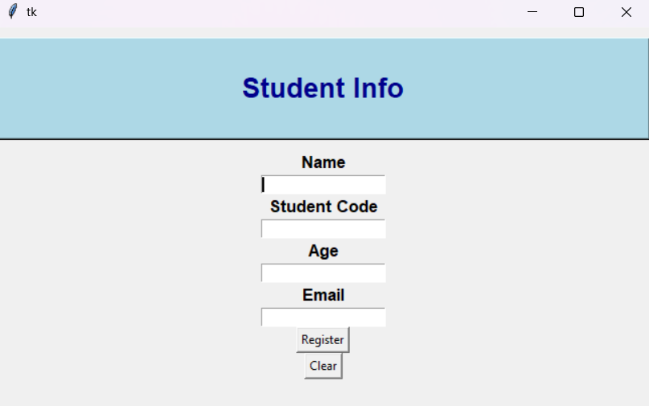
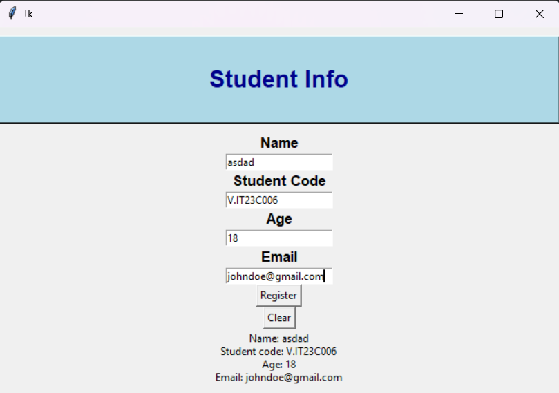
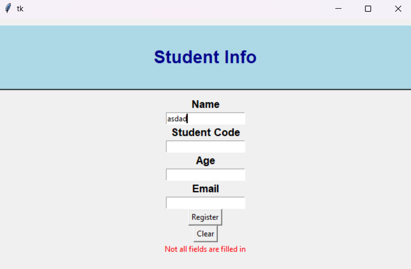
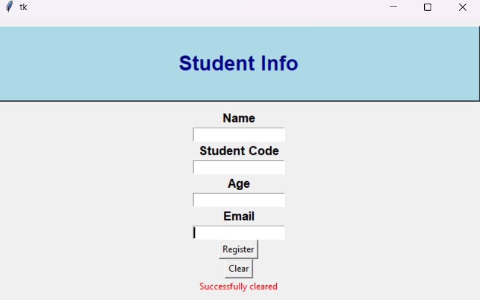

# *Лабораторийн ажил №1*
## Оюутны нэр: Г.Хосбаяр
## Оюутны код: V.IT23C006
## Огноо: 09/18/2026

---

# 1. Ажлын зорилго

Анхан шатны оюутны мэдээллийг харуулсан gui бүхий программ бичих

# 2. Хэрэгжүүлсэн GUI-ийн screenshot

# 3. Программын эх код
```python
import tkinter as tk
root = tk.Tk()
root.geometry('650x500')
def show_profile():
    result.config(text="")
    user_name = name_info.get().strip()
    user_code_info = sc_info.get().strip()
    user_age = age_info.get().strip()
    user_email = email_info.get().strip()

    if user_name == "" or user_code_info == "" or user_age == "" or user_email == "":
        result.config(text="Not all fields are filled in")

    else:
        result.config(text=(f"Name: {user_name}\n"
                  f"Student code: {user_code_info}\n"
                  f"Age: {user_age}\n"
                  f"Email: {user_email}"), fg="black")

    result.pack()

def clear():
    name_info.delete(0, tk.END)
    age_info.delete(0, tk.END)
    email_info.delete(0, tk.END)
    sc_info.delete(0, tk.END)

    result.config(text="Successfully cleared")
    result.pack()

title = tk.Label(root, text="Student Info", font=("Arial", 20, "bold"), bg="lightblue", fg='darkblue', width=80, height=3, relief="raised")
title.pack(pady=10)

name_label = tk.Label(root, text="Name", font=("Arial", 13, "bold"))
name_label.pack()

name_info = tk.Entry(root)
name_info.pack()

student_code_label = tk.Label(root, text="Student Code", font=("Arial", 13, "bold"))
student_code_label.pack()

sc_info = tk.Entry(root)
sc_info.pack()

age_label = tk.Label(root, text="Age", font=("Arial", 13, "bold"))
age_label.pack()

age_info = tk.Entry(root)
age_info.pack()

email_label = tk.Label(root, text="Email", font=("Arial", 13, "bold"))
email_label.pack()

email_info = tk.Entry(root)
email_info.pack()

register_button = tk.Button(root, text="Register", command=show_profile)
register_button.pack()

clear_button = tk.Button(root, text="Clear", command=clear)
clear_button.pack()

result = tk.Label(root, text="", fg='red')

root.mainloop()
```
# 4. Туршилтын үр дүн



# 5. Тулгарсан асуудал ба шийдвэр
Асуудал:

• Clear функцийг бичихэд хүндрэлтэй байсан.
• Хэрхэн entry доторх утгыг арилгах талаар мэдэхгүй байсан.

Шийдэл:

• .delete method-ийг documentations сайтаас уншиж ашигласан.

# 6. Дүгнэлт

Энэ лаб-аар хийснээрээ хэрхэн GUI гаргаж, Entry, Label, Button зэрэг
Widget-ийг ашиглан зохиолын Callback function-ийг зөв
хэрэгжүүлж сурсан. Жишээ нь clear function-ийг
хэрэглэгчийн хүссэн үед entry доторх утгыг арилгах аргыг мэдэхгүй байсан ч Online documentation ашиглан 
бичиж чадсан
