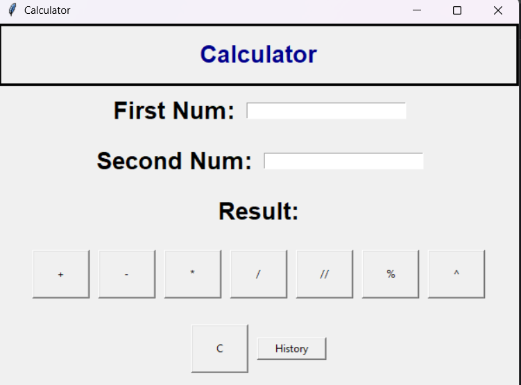
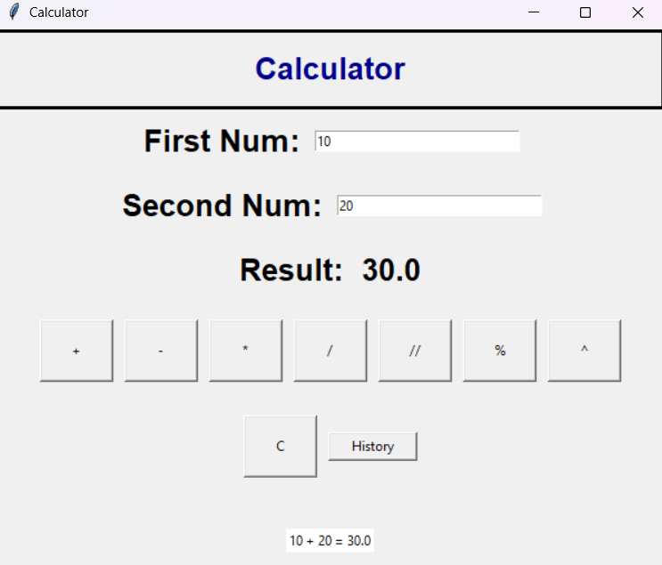
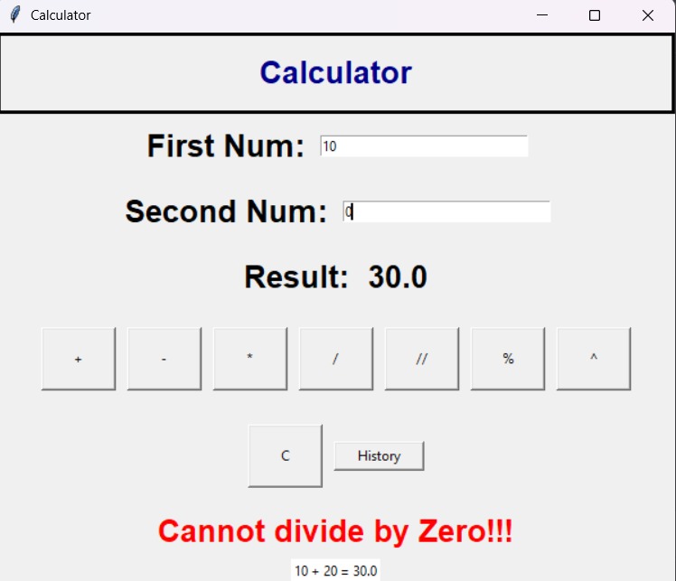
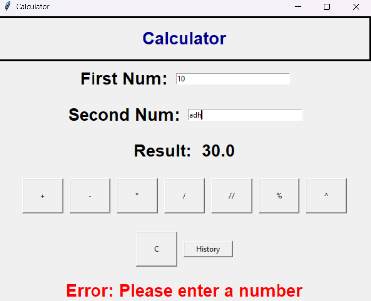

# ЛАБОРАТОРИЙН АЖИЛ №2 Calculator GUI Application
## Оюутны нэр: Г.Хосбаяр
## Оюутны код: V.IT23C006
## Огноо: 09/20/2026
# 1. Ажлын зорилго 
Tkinter library-ийг ашиглан анхан шатны Calculator app бүтээх болон frame widget-ийг ашиглан 
Button - уудыг нэг эгнээд оруулах.
# 2. Боловсруулсан GUI

# 3. Программын эх код
```python
import tkinter as tk
root = tk.Tk()
screen_width = 600
screen_height = 500
root.title("Calculator")
root.geometry(f'{str(screen_width)}x{str(screen_height)}')
history_list = []
chosen_op = []
result = []
#attributes = [width, height]
op_btn_attr = [8,3]
def plus_op():
    try:
        choose_operation("+")
        num1 = float(num1_entry.get().strip())
        num2 = float(num2_entry.get().strip())
        result.clear()
        result.append(str(num1 + num2))
        plus_button.config(state=tk.DISABLED, relief=tk.SUNKEN)
    except ValueError:
        warning_label.config(text="Error: Please enter a number", font=("Arial", 20, "bold"), fg='red')

def minus_op():
    try:
        choose_operation("-")
        num1 = float(num1_entry.get().strip())
        num2 = float(num2_entry.get().strip())
        result.clear()
        result.append(str(num1 - num2))
        minus_button.config(state=tk.DISABLED, relief=tk.SUNKEN)
    except ValueError:
        warning_label.config(text="Error: Please enter a number", font=("Arial", 20, "bold"), fg='red')

def multi_op():
    try:
        choose_operation("*")
        num1 = float(num1_entry.get().strip())
        num2 = float(num2_entry.get().strip())
        result.clear()
        result.append(str(num1 * num2))
        multi_button.config(state=tk.DISABLED, relief=tk.SUNKEN)
    except ValueError:
        warning_label.config(text="Error: Please enter a number", font=("Arial", 20, "bold"), fg='red')

def divide_op():
    try:
        choose_operation("/")
        num1 = float(num1_entry.get().strip())
        num2 = float(num2_entry.get().strip())
        if num2 == 0:
            warning_label.config(text = 'Cannot divide by Zero!!!', font=("Arial", 20, "bold"), fg='red')
        else:
            result.clear()
            result.append(str(round((num1 / num2),5)))
            divide_button.config(state=tk.DISABLED, relief=tk.SUNKEN)
    except ValueError:
        warning_label.config(text="Error: Please enter a number", font=("Arial", 20, "bold"), fg='red')

def quotient_divide_op():
    try:
        choose_operation("//")
        num1 = float(num1_entry.get().strip())
        num2 = float(num2_entry.get().strip())
        if num2 == 0:
            warning_label.config(text = 'Cannot divide by Zero!!!', font=("Arial", 20, "bold"), fg='red')
        else:
            result.clear()
            result.append(str(num1 // num2))
            quotient_divide_button.config(state=tk.DISABLED, relief=tk.SUNKEN)
    except ValueError:
        warning_label.config(text="Error: Please enter a number", font=("Arial", 20, "bold"), fg='red')

def remainder_divide_op():
    try:
        choose_operation("%")
        num1 = float(num1_entry.get().strip())
        num2 = float(num2_entry.get().strip())
        if num2 == 0:
            warning_label.config(text = 'Cannot divide by Zero!!!', font=("Arial", 20, "bold"), fg='red')
        else:
            result.clear()
            result.append(str(num1 % num2))
            remainder_button.config(state=tk.DISABLED, relief=tk.SUNKEN)
    except ValueError:
        warning_label.config(text="Error: Please enter a number", font=("Arial", 20, "bold"), fg='red')

def power_op():
    try:
        choose_operation("^")
        num1 = float(num1_entry.get().strip())
        num2 = float(num2_entry.get().strip())
        result.clear()
        result.append(str(num1 ** num2))
        power_button.config(state=tk.DISABLED, relief=tk.SUNKEN)
    except ValueError:
        warning_label.config(text="Error: Please enter a number", font=("Arial", 20, "bold"), fg='red')

def add_to_history(result, num1, num2, operation):
    if len(history_list) == 3:
        history_list.pop()
        history_list.insert(0,f'{num1} {operation} {num2} = {result[0]}')
    else:
        history_list.insert(0,f'{num1} {operation} {num2} = {result[0]}')
    history_label.config(text="")
    warning_label.config(text="")

def history():
    h_list = "\n".join(history_list)
    history_label.config(text=h_list)
    history_label.pack()

def clear_nums():
    num1_entry.delete(0, tk.END)
    num2_entry.delete(0, tk.END)
    warning_label.config(text="")
    result_label.config(text="")
    history_label.config(text="")

def close_calculator(event):
    root.destroy()

def choose_operation(operation):
    if chosen_op:
        prev_op = chosen_op[0]
        change_operation()
        chosen_op.pop()
        chosen_op.append(operation)
    else:
        chosen_op.append(operation)

def calculate(event):
    num1 = num1_entry.get().strip()
    num2 = num2_entry.get().strip()
    result_label.config(text=result[0])
    result_label.pack(padx=5, side=tk.RIGHT)
    add_to_history(result, num1, num2, chosen_op[0])
    change_operation()

def change_operation():
    if chosen_op[0] == "+":
        plus_button.config(state=tk.NORMAL, relief=tk.RAISED)
    elif chosen_op[0] == "-":
        minus_button.config(state=tk.NORMAL, relief=tk.RAISED)
    elif chosen_op[0] == "*":
        multi_button.config(state=tk.NORMAL, relief=tk.RAISED)
    elif chosen_op[0] == "/":
        divide_button.config(state=tk.NORMAL, relief=tk.RAISED)
    elif chosen_op[0] == "//":
        quotient_divide_button.config(state=tk.NORMAL, relief=tk.RAISED)
    elif chosen_op[0] == "%":
        remainder_button.config(state=tk.NORMAL, relief=tk.RAISED)
    elif chosen_op[0] == "^":
        power_button.config(state=tk.NORMAL, relief=tk.RAISED)

root.bind("<Escape>", close_calculator)
root.bind("<Return>", calculate)

title_label = tk.Label(root, text="Calculator", font=("Arial", 20, "bold"), fg="darkblue", borderwidth=3, relief="solid", width=80, height=2)
title_label.pack()

num1_frame = tk.Frame(root)
num1_frame.pack(pady=10)

num2_frame = tk.Frame(root)
num2_frame.pack(pady=10)

num1_label = tk.Label(num1_frame, text="First Num:", font=("Arial", 20, "bold"))
num1_label.pack(padx=5, side=tk.LEFT)

num1_entry = tk.Entry(num1_frame, width=30)
num1_entry.pack(padx=5, side=tk.RIGHT)

num2_label = tk.Label(num2_frame, text="Second Num:", font=("Arial", 20, "bold"))
num2_label.pack(padx=5, side=tk.LEFT)

num2_entry = tk.Entry(num2_frame, width=30)
num2_entry.pack(padx=5, side=tk.RIGHT)

result_frame = tk.Frame(root)
result_frame.pack(pady=10)

operation_button_frame = tk.Frame(root)
operation_button_frame.pack(pady=15)

action_button_frame = tk.Frame(root)
action_button_frame.pack(pady=15)

result_text_label = tk.Label(result_frame, text="Result:", font=("Arial", 20, "bold"))
result_text_label.pack(padx=5, side=tk.LEFT)

result_label = tk.Label(result_frame, text="", font=("Arial", 20, "bold"))

plus_button = tk.Button(operation_button_frame, width=op_btn_attr[0], height=op_btn_attr[1], text="+", command=plus_op)
plus_button.pack(padx=5, side=tk.LEFT)

minus_button = tk.Button(operation_button_frame, width=op_btn_attr[0], height=op_btn_attr[1], text="-", command=minus_op)
minus_button.pack(padx=5, side=tk.LEFT)

multi_button = tk.Button(operation_button_frame, width=op_btn_attr[0], height=op_btn_attr[1], text="*", command=multi_op)
multi_button.pack(padx=5, side=tk.LEFT)

divide_button = tk.Button(operation_button_frame, width=op_btn_attr[0], height=op_btn_attr[1], text="/", command=divide_op)
divide_button.pack(padx=5, side=tk.LEFT)

quotient_divide_button = tk.Button(operation_button_frame, width=op_btn_attr[0], height=op_btn_attr[1], text="//", command=quotient_divide_op)
quotient_divide_button.pack(padx=5, side=tk.LEFT)

remainder_button = tk.Button(operation_button_frame, width=op_btn_attr[0], height=op_btn_attr[1], text="%", command=remainder_divide_op)
remainder_button.pack(padx=5, side=tk.LEFT)

power_button = tk.Button(operation_button_frame, width=op_btn_attr[0], height=op_btn_attr[1], text="^", command=power_op)
power_button.pack(padx=5, side=tk.LEFT)

clear_button = tk.Button(action_button_frame, width=8, height=3, text="C", command=clear_nums)
clear_button.pack(padx=5, side=tk.LEFT)

warning_label = tk.Label(root, text='')
warning_label.pack(pady=5)

history_label = tk.Label(root, text='', fg="black", bg="white")

history_button = tk.Button(action_button_frame, width=10, text="History", command=history)
history_button.pack(padx=5, side=tk.LEFT)

root.mainloop()
```
# 4. Callback функцуудын тайлбар
1. ### _op нэртэй callback функцууд
    Дээрх кодонд байгаа бүх _op нэртэй callback функцууд нь өөр өөрсдийнхөө арифметик болон төрөл бүрийн 
    хуваах үйлдлийг гүйцэтгэнэ. Бүгдээрээ эхлээд хэрэглэгчийг хоёр entry-д үсэг оруулсан эсвэл хоосон үлдээсэн 
    эсэхийг try keyword-ийг ашиглан шалгаж, хэрэв ямарч алдаа гарахгүй бол num1, num2-ийг entry-ээс .strip() 
    ашиглан ард болон урд талын хоосон зайг арилгаж, float болгон хадгална. Дараа нь өмнөх хариултыг устгаад, 
    шинэ хариугаа тооцоолоно. Тэгээд эцэст нь товчлуурыг дарсан гэж харагдуулахын тулд button-ыг disable хийнэ.
   - Plus_op:
   Нэмэх үйлдлийг гүйцэтгэнэ.
   - Minus_op:
   Хасах үйлдлийг гүйцэтгэнэ.
   - Multi_op:
   Үржих үйлдэлийг гүйцэтгэнэ.
   - Divide_op:
   Хуваах үйлдлийг гүйцэтгэнэ. Мөн TypeError шалгахаас гадна ZeroDivisionError бас шалгана
   - Quotient_op:
   Бүхлээр хуваах үйлдлийг гүйцэтгэнэ. Мөн TypeError шалгахаас гадна ZeroDivisionError бас шалгана
   - Remainder_op:
   Үлдэгдлээр хуваах үйлдэл гүйцэтгэнэ. Мөн TypeError шалгахаас гадна ZeroDivisionError бас шалгана
   - Power_op:
   Зэрэгт дэвшүүлэх үйлдэл гүйцэтгэнэ.
2. ### History callback функц
    Энэ функц нь History button дарагдсан үед ажиллах ба сүүлд хийгдсэн гурван тооцоололыг
    харуулна. History нь List хэлбэртэй хадаглагдаж байгаа бөгөөд дэлгэцэнд харуулахдаа List доторх
    item бүрээр "\n" аар нийлүүлж history_label-ийн text утгыг шинэчлэнэ.
3. ### Clear_nums callback функц
    Энэ функц нь дэлгэцэн дээр байгаа хоёр entry дотор утгыг, history_label-ийн text-ийг,
    анхааруулах text-ийг, болон гарсан үр дүнг бүгдийг нь дэлгэцэнд гаргахгүй болгоно.
# 5. Туршилтын үр дүн



# 6. Илэрсэн алдаа ба шийдэл
### Алдаа:
1. Үйлдэл хийх товчийг нэг дор олон дахин дарах
2. Үйлдэл хооронд шилжих боломжгүй
3. Товчлуур дарагдсан эсэхийг харах боломжгүй
4. _op callback функц дотор тооцоолол явагдаж, товчлуур солигдох явцад history-д нэмэгдэх
5. Товчлуур буцаад ашиглагдах боломжгүй байх
### Шийдэл:
1. Товчлуурыг дарах үед, товчлуурыг disable хийгээд enter дарж үр дүн дэлгэцэнд гарах 
хүртэл disabled хэвээр байлгах
2. Нэг товчлуур дарсаны дараа, өөр нэг товчлуур сонгох хэрэгтэй болвол,chosen_op гэсэн хувьсагчийг 
өөрчилж, тэр утгаар нь if нөхцөл шалгах change_op функцийг оруулж өгсөн
3. Товчлуурын хүрээний төрлийг Sunken болгож хэрэглэгчид илүү ойлгожтойгоор дэлгэцэнд
хэвлэсэх
4. _op функц дотор үр дүнгийн widget-ийн text-ийг шинэчилэхийг больж, enter дарах үед 
шинэчилдэг болсоноор history-д илүү history нэмэгдэхийг болиулсан
5. Үр дүн гарсаны дараа товчлуурын state-ийг буцаагаад normal болгож, хүрээний төрлийг Raised 
болгож зассан
# 7. Дүгнэлт
Энэхүү лаб-ийг хийснээр хэрхэн товчлуурын state handle хийх, Frame дотор widget-үүдийг 
render хийх, keyboard-ны товчлуур дарсан эсэхийг шалгаж, түүгээр дамжуулан хариуг дэлгэцэнд гаргах,
APP-ийг бүр мөсөн унтраах зэргийг ойлгож, өөрийн tkinter library-ийг ашиглан APP бичих 
чадварыг дээшлүүлж чадсан.