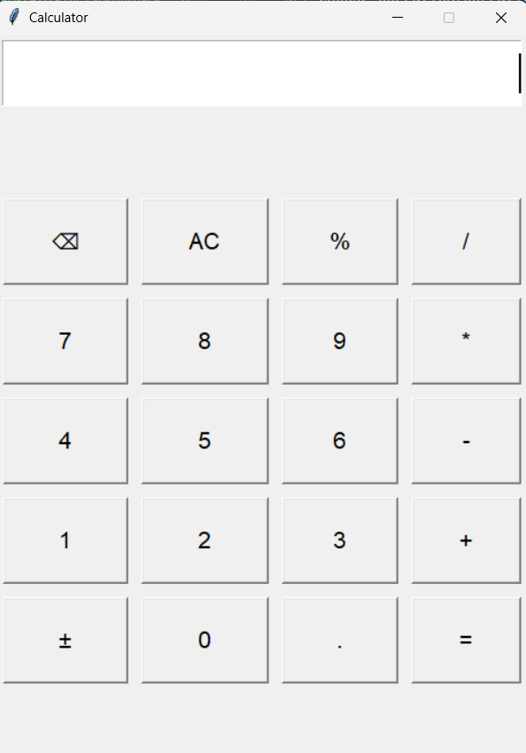
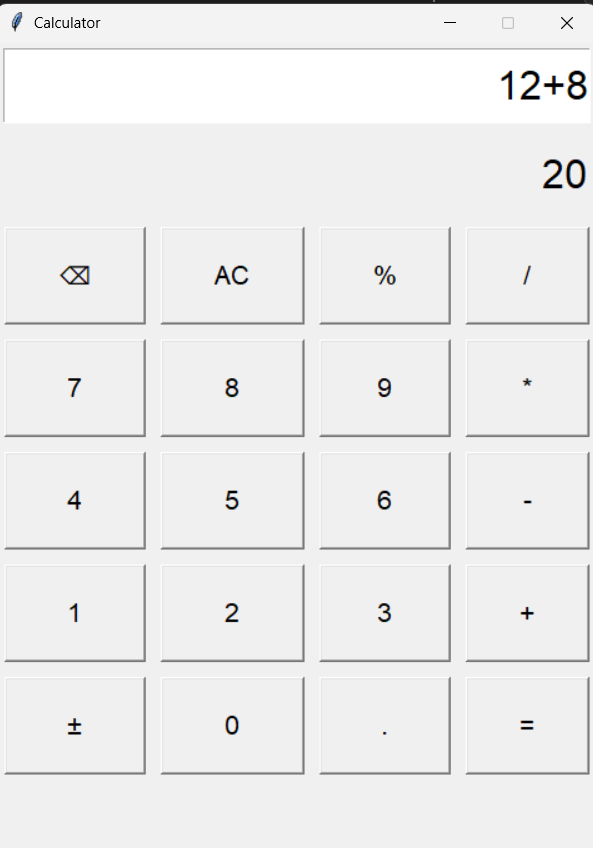
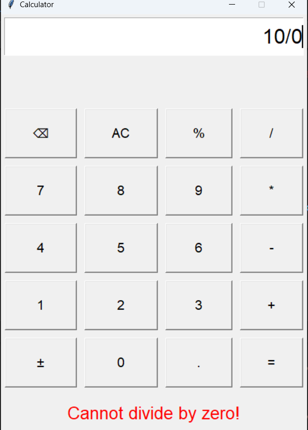

# _Лабораторийн ажил №1_

## Оюутны нэр: Г.Хосбаяр

## Оюутны код: V.IT23C006

## Огноо: 10/14/2026

---

# 1. Ажлын зорилго

Lab 2 дээр бичсэн calculator-ийг өргөжүүлж, шинэчлэх.

# 2. Хэрэгжүүлсэн GUI-ийн screenshot





# 3. Программын эх код

```python
import tkinter as tk
root = tk.Tk()
root.title("Calculator")
root.geometry("480x660")
root.resizable(False, False)

for col in range(4):
    root.columnconfigure(col, weight=1)

for row in range(2, 7):
    root.rowconfigure(row, weight=1)

BUTTON_PADX = 6
BUTTON_PADY = 6
MAX_LENGTH = 20

layout = [["⌫", "AC", "%", "/"],
          ["7", "8", "9", "*"],
          ["4", "5", "6", "-"],
          ["1", "2", "3", "+"],
          ["±", "0", ".", "="]]

operation_list = ["%", "/", "+", "-", "*"]

def handle_btn(clicked_btn):
    if clicked_btn == "⌫":
        backspace()
    elif clicked_btn == "AC":
        all_clear()
    elif clicked_btn in operation_list:
        choose_operation(clicked_btn)
    elif clicked_btn == "=":
        calculate()
    elif clicked_btn == ".":
        dot()
    elif clicked_btn == "±":
        plus_or_minus()
    else:
        enter_num(clicked_btn)

def on_key(event):
    key = event.char
    sym = event.keysym

    if sym == "BackSpace":
        backspace()
    elif sym == "Escape":
        all_clear()
    elif sym == "Return" or key == "=":
        calculate()
    elif key.isdigit():
        enter_num(key)
    elif key in operation_list:
        choose_operation(key)
    elif key == ".":
        dot()

    return "break"

def backspace():
    number_entry.delete(len(number_entry.get())-1)
    clear_warning()

def all_clear():
    clear_number()
    clear_warning()
    clear_answer()

def choose_operation(operation):
    if output_label.cget('text') != "":
        clear_number()
        number_entry.insert(tk.END, f"{output_label.cget('text')}" + operation)
        clear_answer()
    else:
        if is_full():
            config_warning(f"Maximum equation length is {MAX_LENGTH}")
        elif get_entry() == "" or get_entry()[-1] in operation_list:
            config_warning('Please enter a number first!!!')
        else:
            number_entry.insert(tk.END, operation)
            clear_warning()


def enter_num(number):
    if is_full():
        config_warning(f"Maximum equation length is {MAX_LENGTH}")
        return
    else:
        number_entry.insert(tk.END, number)
        clear_answer()
        clear_warning()

def get_entry():
    return number_entry.get().strip()

def is_full():
    return len(get_entry()) >= MAX_LENGTH

def config_warning(warning):
    warning_label.config(text=warning)

def clear_warning():
    warning_label.config(text="")

def clear_answer():
    output_label.config(text="")

def clear_number():
    number_entry.delete(0,tk.END)

def calculate():
    try:
        clear_warning()
        equation = get_entry()
        if equation == "" or not equation[-1].isdigit():
            config_warning("Incomplete equation!!!")
        else:
            answer = round(eval(equation),10)
            output_label.config(text=answer)
    except ZeroDivisionError:
        config_warning("Cannot divide by zero!")

def plus_or_minus():
    equation = get_entry()
    if equation == "" or not equation[-1].isdigit():
        config_warning('Enter a number first!!!')
    else:
        for i in range(1, len(equation)+1):
            if equation[-i] in operation_list:
                if equation[-i-1] == "(":
                    equation = equation[:-i-1] + equation[-i+1:-1]
                else:
                    equation = equation[0:-i+1] + f"(-{equation[-i+1:]})"
                clear_number()
                number_entry.insert(tk.END, equation)
                return
        equation = f"(-{equation})"
        clear_number()
        number_entry.insert(tk.END, equation)

def dot():
    equation = get_entry()
    for i in range(1, len(equation)+1):
        if equation[-i] in operation_list:
            break
        elif equation[-i] == ".":
            config_warning("Cannot add another dot!!!")
            return

    if equation == "" or not equation[-1].isdigit():
        number_entry.insert(tk.END, "0.")
    else:
        number_entry.insert(tk.END, ".")

for i in range(len(layout)):
    for j in range(len(layout[i])):
        btn = tk.Button(text=f"{layout[i][j]}", font=("Arial", 16), command=lambda value=layout[i][j] : handle_btn(value))
        btn.grid(row=i+2, column=j, sticky="nsew", padx=BUTTON_PADX, pady=BUTTON_PADY)

number_entry = tk.Entry(font=("Arial", 24), justify="right")
number_entry.grid(row=0, columnspan=4, sticky="ew", padx=5, pady=5, ipady=10)
number_entry.focus_set()

output_label = tk.Label(font=("Arial", 24))
output_label.grid(row=1, columnspan=4, sticky="e", padx=5, pady=5, ipady=10)

warning_label = tk.Label(font=("Arial", 20), fg="red")
warning_label.grid(row=7, columnspan=4, sticky="ew", padx=5, pady=5, ipady=10)

number_entry.bind("<Key>", on_key)

root.mainloop()
```

# 4. Туршилтын үр дүн

| ID  | Товчлуурын дараалал         | Хүлээгдсэн                     | Үр дүн       |
| --- | --------------------------- | ------------------------------ | ------------ |
| T01 | `1 2 + 8 =`                 | 20                             | 20           |
| T02 | `9 - 1 4 =`                 | -5                             | -5           |
| T03 | `6 × 7 =`                   | 42                             | 42           |
| T04 | `7 ÷ 2 =`                   | 3.5                            | 3.5          |
| T05 | `0 . 1 + 0 . 2 =`           | 0.3                            | 0.3          |
| T06 | `1 . . 2`                   | 1.2                            | 1.2          |
| T07 | `2 + . 5 =`                 | 2.5                            | 2.5          |
| T08 | `1 2 3 ⌫`                   | 12                             | 12           |
| T09 | `5 ± ⌫`                     | 0                              | 0            |
| T10 | `5 ± ±`                     | 5                              | 5            |
| T11 | `0 ± . 5`                   | -0.5                           | x            |
| T12 | `0 0 0 5`                   | 5                              | 5            |
| T13 | `5 0 %`                     | 0.5                            | x            |
| T14 | `2 0 0 + 1 0 % =`           | 200.1                          | x            |
| T15 | `8 ÷ 0 =`                   | Error                          | error        |
| T16 | `8 ÷ 0 = 3`                 | 3                              | x            |
| T17 | `1 2 + AC 3 =`              | 3                              | 3            |
| T18 | `1 2 + × 2 =`               | 24                             | 24           |
| T19 | `2 + 3 × 4 =`               | 20                             | x            |
| T20 | `2 + =`                     | 2 (operator `+` stays pending) | 2            |
| T21 | `2 + 3 = =`                 | 5                              | 5            |
| T22 | `2 + 3 = 7`                 | 7                              | x            |
| T23 | `9 + ⌫ 2 =`                 | 11                             | x            |
| T24 | `1 2 3 4 5 6 7 8 9 0 1 2 3` | 123456789012                   | 123456789012 |
| T25 | `0 . 0 0 0 0 0 0 0 1 % 2 =` | 2                              | x            |

---

# 5. Тулгарсан асуудал ба шийдвэр

Асуудал:

• Calculate функц тоог тэг-д хуваах алдааг гаргахгүй байсан

Шийдэл:

• Try, except ашиглан ZeroDivisionError-ийг хүлээж, гарсан тохиолдолд warning_label -ийг configure хийн text утгыг нь шинэчилж дэлгэцэнд харуулсан.

# 6. Дүгнэлт

Энэ лаб-аар хийснээрээ хэрхэн Lambda operator ашиглан callback функц-ээр утга дамжуулахыг сурч, хэрэглэгчийн keyboard-оос key дарахад
ямар key дарагдсаныг шалгаж, хэрэв зөв key байвал тохирох Command-ийг ажиллуулж сурсан.
