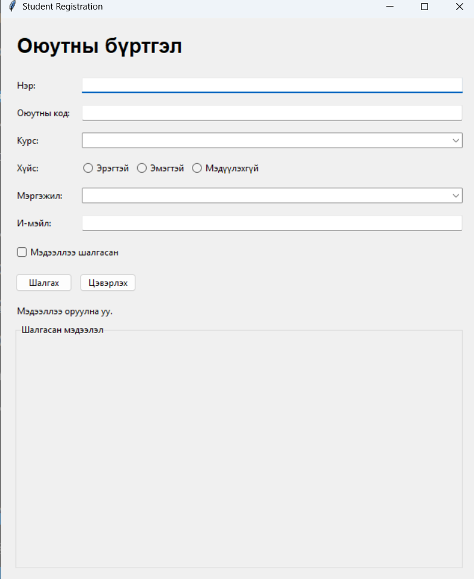
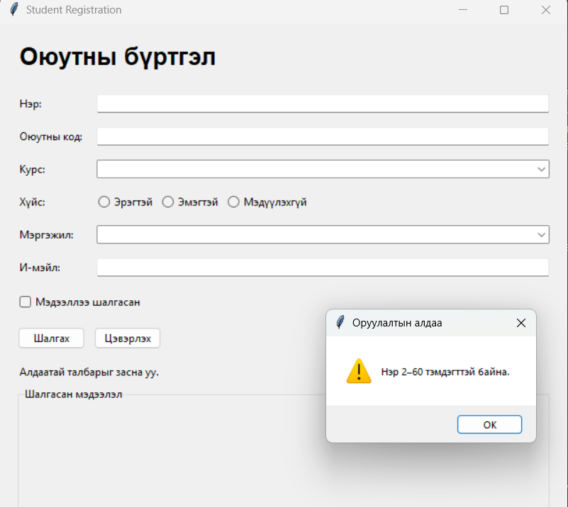
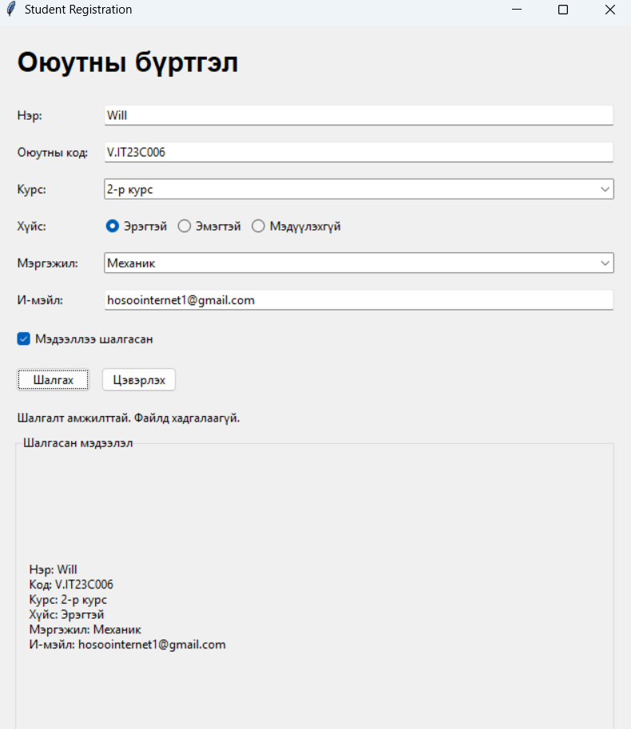

# ЛАБОРАТОРИЙН АЖИЛ №3 Student Registration Form

## Оюутны нэр: Г.Хосбаяр

## Оюутны код: V.IT23C006

## Огноо: 10/01/2026

# 1. Ажлын зорилго

Tkinter library-ийг ашиглан оюутны бүртгэлийн маягт бүтээх. Entry, Combobox, Radiobutton, Checkbutton зэрэг олон төрлийн widget-ийг нэг маягтад ашиглаж, оруулсан өгөгдлийг хэвийн болгох (normalize), шалгах (validate) болон үр дүнг цонхонд харуулах. Энэ лабораторид өгөгдлийг файл эсвэл өгөгдлийн санд хадгалахгүй.

# 2. Боловсруулсан GUI



# 3. Программын эх код

```python
import re
import tkinter as tk
from tkinter import ttk, messagebox

COURSES = ["1-р курс", "2-р курс", "3-р курс", "4-р курс"]
MAJORS = ["Мэдээллийн технологи", "Механик", "Цахилгаан"]
GENDERS = ["Эрэгтэй", "Эмэгтэй", "Мэдүүлэхгүй"]
CODE_PATTERN = r"B[0-9]{2}[A-Z]{2}[0-9]{3}"
EMAIL_PATTERN = r"[^\s@]+@[^\s@.]+(?:\.[^\s@.]+)+"


def normalize(raw):
    data = {}
    for key in raw:
        if key == "agree":
            data[key] = raw[key]
        else:
            data[key] = raw[key].strip()
    data["code"] = data["code"].upper()
    return data


def validate(data):
    if not 2 <= len(data["name"]) <= 60:
        return "name", "Нэр 2–60 тэмдэгттэй байна."
    if not re.fullmatch(CODE_PATTERN, data["code"]):
        return "code", "Кодын загвар: B24IT001."
    if data["course"] not in COURSES:
        return "course", "Курсээ сонгоно уу."
    if data["gender"] not in GENDERS:
        return "gender", "Хүйсийн сонголтоо хийнэ үү."
    if data["major"] not in MAJORS:
        return "major", "Мэргэжлээ сонгоно уу."
    if len(data["email"]) > 254 or not re.fullmatch(EMAIL_PATTERN, data["email"]):
        return "email", "И-мэйлээ name@example.com хэлбэрээр оруул."
    if data["agree"] is not True:
        return "agree", "Мэдээллээ шалгаснаа тэмдэглэнэ үү."
    return None


def summary(data):
    text = f"Нэр: {data['name']}\nКод: {data['code']}\n"
    text += f"Курс: {data['course']}\nХүйс: {data['gender']}\n"
    text += f"Мэргэжил: {data['major']}\nИ-мэйл: {data['email']}"
    return text


root = tk.Tk()
root.title("Student Registration")
root.geometry("640x760")
root.minsize(620, 720)
root.columnconfigure(0, weight=1)
root.rowconfigure(0, weight=1)

form = ttk.Frame(root, padding=20)
form.grid(row=0, column=0, sticky="nsew")
form.columnconfigure(1, weight=1)

fields = ["name", "code", "course", "gender", "major", "email"]
labels = ["Нэр", "Оюутны код", "Курс", "Хүйс", "Мэргэжил", "И-мэйл"]

variables = {}
for key in fields:
    variables[key] = tk.StringVar(root)
variables["agree"] = tk.BooleanVar(root, value=False)

result_var = tk.StringVar(root)
status_var = tk.StringVar(root, value="Мэдээллээ оруулна уу.")

widgets = {}


def mark_dirty(*args):
    result_var.set("")
    status_var.set("Өөрчлөгдсөн. Дахин шалгуулна уу.")


def submit(event=None):
    raw = {}
    for key in variables:
        raw[key] = variables[key].get()
    data = normalize(raw)
    issue = validate(data)
    result_var.set("")

    if issue:
        key, message = issue
        status_var.set("Алдаатай талбарыг засна уу.")
        messagebox.showwarning("Оруулалтын алдаа", message, parent=root)
        widgets[key].focus_set()
        return "break"

    for key in data:
        variables[key].set(data[key])
    result_var.set(summary(data))
    status_var.set("Шалгалт амжилттай. Файлд хадгалаагүй.")
    return "break"


def clear_form():
    for key in fields:
        variables[key].set("")
    variables["agree"].set(False)
    result_var.set("")
    status_var.set("Мэдээллээ оруулна уу.")
    widgets["name"].focus_set()


title_label = ttk.Label(form, text="Оюутны бүртгэл", font=("Arial", 20, "bold"))
title_label.grid(row=0, column=0, columnspan=2, sticky="w", pady=(0, 16))

row = 1
for i in range(len(fields)):
    key = fields[i]
    ttk.Label(form, text=labels[i] + ":").grid(row=row, column=0, sticky="w", padx=(0, 14), pady=8)

    if key == "course":
        widget = ttk.Combobox(form, textvariable=variables[key], values=COURSES, state="readonly")
    elif key == "major":
        widget = ttk.Combobox(form, textvariable=variables[key], values=MAJORS, state="readonly")
    elif key == "gender":
        gender_frame = ttk.Frame(form)
        gender_frame.grid(row=row, column=1, sticky="w", pady=8)
        for value in GENDERS:
            radio = ttk.Radiobutton(gender_frame, text=value, value=value, variable=variables[key])
            radio.pack(side="left", padx=(0, 6))
            if value == GENDERS[0]:
                widgets[key] = radio
        row += 1
        continue
    else:
        widget = ttk.Entry(form, textvariable=variables[key])

    widget.grid(row=row, column=1, sticky="ew", pady=8)
    widgets[key] = widget
    row += 1

widgets["agree"] = ttk.Checkbutton(form, text="Мэдээллээ шалгасан", variable=variables["agree"])
widgets["agree"].grid(row=7, column=0, columnspan=2, sticky="w", pady=10)

actions = ttk.Frame(form)
actions.grid(row=8, column=0, columnspan=2, sticky="w", pady=8)

submit_button = ttk.Button(actions, text="Шалгах", command=submit)
submit_button.pack(side="left", padx=(0, 10))

clear_button = ttk.Button(actions, text="Цэвэрлэх", command=clear_form)
clear_button.pack(side="left")

status_label = ttk.Label(form, textvariable=status_var, wraplength=550)
status_label.grid(row=9, column=0, columnspan=2, sticky="w", pady=8)

result_box = ttk.LabelFrame(form, text="Шалгасан мэдээлэл", padding=10)
result_box.grid(row=10, column=0, columnspan=2, sticky="nsew")
form.rowconfigure(10, weight=1)

result_label = ttk.Label(result_box, textvariable=result_var, wraplength=530, justify="left")
result_label.pack(fill="both", expand=True)

for key in variables:
    variables[key].trace_add("write", mark_dirty)

root.bind("<Control-Return>", submit)
widgets["name"].focus_set()

root.mainloop()
```

# 4. Функц болон widget-үүдийн тайлбар

1. ### Тогтмол утгууд
   - COURSES: 1-р курсээс 4-р курс хүртэлх жагсаалт.
   - MAJORS: Мэдээллийн технологи, Механик, Цахилгаан.
   - GENDERS: Эрэгтэй, Эмэгтэй, Мэдүүлэхгүй.
   - CODE_PATTERN: Оюутны кодын загвар. B + 2 цифр + 2 латин үсэг + 3 цифр (жишээ нь B24IT001). `\d` биш `[0-9]` ашигласан тул зөвхөн ASCII цифр хүлээн авна.
   - EMAIL_PATTERN: И-мэйлийн энгийн бүтцийн загвар. Нэг @, домэйнд цэг, хоосон хэсэггүй, whitespace-гүй байх ёстой.
2. ### normalize функц
   Энэ функц нь хэрэглэгчийн оруулсан өгөгдлийг нэг хэлбэрт оруулна. Бүх текстэн утгын өмнөх болон хойно байгаа хоосон зайг .strip()-ээр арилгаж, оюутны кодыг .upper()-ээр том үсэгт шилжүүлнэ. Тиймээс " b24it001 " гэж оруулсан код "B24IT001" болно. Checkbutton-ы утга (agree) True/False учраас өөрчлөхгүй. normalize нь зөв эсвэл буруу гэж шийдэхгүй, зөвхөн өгөгдлийг цэвэрлэнэ.
3. ### validate функц

   Энэ функц нь хэвийн болгосон өгөгдлийг дарааллаар нь шалгана. Алдаагүй бол None, алдаатай бол (талбарын нэр, тайлбар) буцаана. Зөвхөн **эхний** алдааг буцаадаг бөгөөд хэрэглэгч засаад дахин шалгана.

   - Нэр: 2-60 тэмдэгт байх.
   - Код: CODE_PATTERN-д бүтнээрээ тохирох.
   - Курс, хүйс, мэргэжил: жагсаалтад байгаа утга байх.
   - И-мэйл: 254 тэмдэгтээс ихгүй бөгөөд EMAIL_PATTERN-д бүтнээрээ тохирох.
   - Шалгасан тэмдэг: True байх.

   re.fullmatch() нь бүх текст загварт тохирохыг шаарддаг. re.match() бол зөвхөн эхлэлийг шалгадаг тул "B24IT001x" кодыг буруу зөвшөөрөх байсан. Combobox нь readonly боловч курс, мэргэжлийг validate дотор дахин шалгасан. Учир нь утга программын аргаар өөрчлөгдсөн ч дүрэм мөрдөгдөх ёстой. И-мэйлийн regex нь хаяг бодитоор байгааг батлахгүй, зөвхөн бүтцийг шалгана.

4. ### summary функц
   Зөв өгөгдлийг (нэр, код, курс, хүйс, мэргэжил, и-мэйл) олон мөр бүхий нэг текст болгож буцаана. Энэ текст үр дүнгийн хэсэгт харагдана.
5. ### mark_dirty callback функц
   trace_add("write", ...)-ээр бүх хувьсагчид холбогдсон. Аль нэг талбар өөрчлөгдөх бүрт үр дүнг цэвэрлэж, төлөвийг "Өөрчлөгдсөн. Дахин шалгуулна уу." болгоно. Ингэснээр хуучин үр дүн зөв мэт үлдэхгүй. trace нь нэмэлт аргумент дамжуулдаг тул \*args ашигласан.
6. ### submit callback функц
   Шалгах товч болон Ctrl + Enter хоёулаа энэ функцийг дуудна.
   1. Бүх хувьсагчийг уншиж raw dictionary үүсгэнэ.
   2. normalize(), дараа нь validate() дуудна.
   3. Хуучин үр дүнг цэвэрлэнэ.
   4. Алдаатай бол төлөв шинэчилж, messagebox.showwarning()-аар шалтгааныг харуулан, алдаатай талбар руу focus_set() хийгээд return "break" хийнэ.
   5. Алдаагүй бол хэвийн болгосон утгуудыг талбаруудад буцааж set() хийж, дараа нь үр дүн болон амжилттай төлөвийг бичнэ.
      set() бүр mark_dirty-г ажиллуулж үр дүнг арилгадаг тул үр дүнг **бүх set()-ийн дараа** бичих ёстой. Товч нь функцийг event-гүй, bind нь event-тэй дууддаг тул event=None гэж өгсөн. Мөн command=submit гэж хаалтгүй бичсэн; хаалттай бол цонх нээгдэхэд шууд ажиллана.
7. ### clear_form callback функц
   Зургаан текстэн талбарыг хоосолж, Checkbutton-ыг False болгож, үр дүнг арилгаж, төлөвийг анхны текст болгоод нэрийн талбарт focus өгнө. Төлвийг хамгийн сүүлд тохируулсан тул trace түр ажилласан ч анхны төлөв үлдэнэ.

# 5. Туршилтын үр дүн

## 5.1 Validation тест (T01-T22)

Суурь зөв өгөгдөл: Бат; B24IT001; 4-р курс; Мэдүүлэхгүй; Мэдээллийн технологи; bat@example.com; checkbox=True. Тест бүрд зөвхөн хүснэгтэд заасан талбарыг солино. Эдгээр тестийг normalize() ба validate() функцэд GUI-гүйгээр ажиллуулсан.

| ID  | Өөрчлөлт                              | Хүлээгдсэн үр дүн              | Бодит                   | Үр дүн  |
| --- | ------------------------------------- | ------------------------------ | ----------------------- | ------- |
| T01 | Өөрчлөлтгүй                           | Шалгалт амжилттай              | Амжилттай               | Тэнцсэн |
| T02 | Нэр зөвхөн зай                        | Нэрийн алдаа                   | Нэрийн алдаа            | Тэнцсэн |
| T03 | Нэр 1 тэмдэгт                         | Нэрийн алдаа                   | Нэрийн алдаа            | Тэнцсэн |
| T04 | Нэр 60 тэмдэгт                        | Амжилттай                      | Амжилттай               | Тэнцсэн |
| T05 | Нэр 61 тэмдэгт                        | Нэрийн алдаа                   | Нэрийн алдаа            | Тэнцсэн |
| T06 | Код " b24it001 "                      | B24IT001 болгон хэвийн болгоно | B24IT001, амжилттай     | Тэнцсэн |
| T07 | Код B24IT01                           | Кодын алдаа                    | Кодын алдаа             | Тэнцсэн |
| T08 | Код B24IT001x                         | Кодын алдаа                    | Кодын алдаа             | Тэнцсэн |
| T09 | Кодын 24-ийг U+FF12, U+FF14-өөр солих | ASCII цифр биш тул алдаа       | Кодын алдаа             | Тэнцсэн |
| T10 | Курс хоосон                           | Курсийн алдаа                  | Курсийн алдаа           | Тэнцсэн |
| T11 | Курс 5-р курс                         | Жагсаалтад байхгүй тул алдаа   | Курсийн алдаа           | Тэнцсэн |
| T12 | Хүйс сонгоогүй                        | Хүйсийн сонголтын алдаа        | Хүйсийн алдаа           | Тэнцсэн |
| T13 | Мэргэжил Бусад                        | Жагсаалтад байхгүй тул алдаа   | Мэргэжлийн алдаа        | Тэнцсэн |
| T14 | И-мэйл хоосон                         | И-мэйлийн алдаа                | И-мэйлийн алдаа         | Тэнцсэн |
| T15 | bat.example.com                       | @ байхгүй тул алдаа            | И-мэйлийн алдаа         | Тэнцсэн |
| T16 | bat@@example.com                      | Давхар @ тул алдаа             | И-мэйлийн алдаа         | Тэнцсэн |
| T17 | bat@localhost                         | Домэйнд цэггүй тул алдаа       | И-мэйлийн алдаа         | Тэнцсэн |
| T18 | bat @example.com                      | Дотор зайтай тул алдаа         | И-мэйлийн алдаа         | Тэнцсэн |
| T19 | bat@example..com                      | Домэйны хоосон хэсэгтэй        | И-мэйлийн алдаа         | Тэнцсэн |
| T20 | bat+lab@example.edu.mn                | Амжилттай                      | Амжилттай               | Тэнцсэн |
| T21 | Checkbox=False                        | Шалгаснаа тэмдэглэхийг хүснэ   | Шалгасан тэмдгийн алдаа | Тэнцсэн |
| T22 | И-мэйл 254-өөс урт                    | И-мэйлийн алдаа                | И-мэйлийн алдаа         | Тэнцсэн |

22 тестийн 22 нь тэнцсэн.

## 5.2 UI тест (U01-U10)

Эдгээр тестийг программыг ажиллуулж үзээд "Бодит" болон "Үр дүн" баганыг бөглөнө.

| ID  | Үйлдэл                       | Хүлээгдсэн үр дүн                           | Бодит | Үр дүн |
| --- | ---------------------------- | ------------------------------------------- | ----- | ------ |
| U01 | Бүгд хоосон үед Шалгах       | Нэрийн алдаа; dialog хаахад нэрт focus      |       |        |
| U02 | Зөв бөглөөд Шалгах           | Зургаан талбарын мэдээлэл харагдана         |       |        |
| U03 | U02-ын дараа нэр өөрчлөх     | Өмнөх үр дүн арилж, дахин шалгах төлөв      |       |        |
| U04 | U02-ын дараа checkbox цуцлах | Үр дүн арилна; дахин шалгахад алдаа         |       |        |
| U05 | Цэвэрлэх дарах               | Бүх талбар хоосон, checkbox=False           |       |        |
| U06 | Цэвэрлэхийг дахин дарах      | Алдаагүй, анхны төлөв хэвээр                |       |        |
| U07 | Зөв бөглөөд Ctrl + Enter     | Шалгах товчтой адил үр дүн                  |       |        |
| U08 | Өөр Radio сонгох             | Өмнөх сонголт солигдоно                     |       |        |
| U09 | Цонх томруулах, багасгах     | Widget-үүд давхцахгүй                       |       |        |
| U10 | Урт нэр, урт и-мэйл          | Entry гүйлгэж харуулна; summary мөр шилжинэ |       |        |

## 5.3 Зургууд




# 6. Илэрсэн алдаа ба шийдэл

### Алдаа:

1.

### Шалтгаан:

1.

### Шийдэл:

1.

### Дахин тестийн үр дүн:

1.

# 7. Дүгнэлт

Энэхүү лаб-ийг хийснээр Entry, readonly Combobox, Radiobutton, Checkbutton зэрэг widget-үүдийг StringVar, BooleanVar-тай холбон ашиглах, өгөгдлийг normalize болон validate гэж тусад нь хэрэгжүүлэх, messagebox ба focus_set()-ээр алдааг ойлгомжтой харуулах, trace_add-аар хуучин үр дүнг арилгах, command болон bind-ийг нэг функцтэй холбох, grid ба pack-ийг өөр өөр Frame дотор зөв хэрэглэх зэргийг ойлгож, өөрийн tkinter-ээр маягт бичих чадвараа дээшлүүлсэн.
